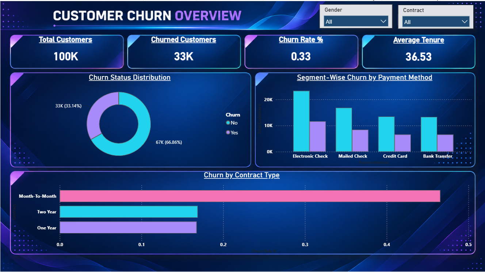
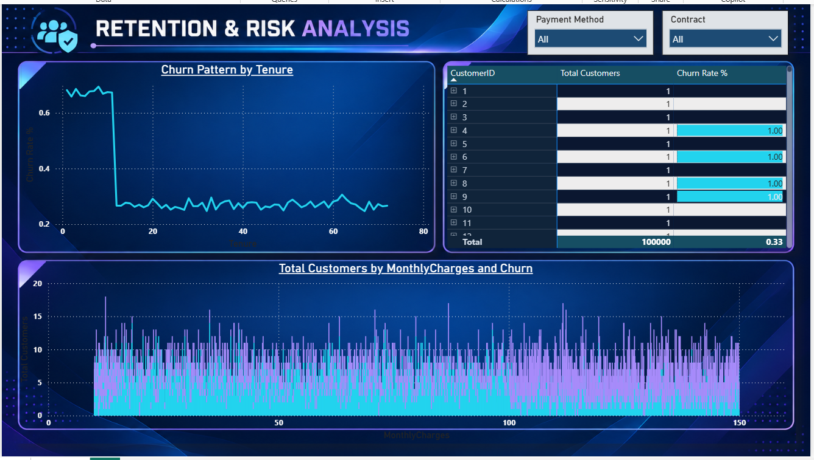

# 📉 Customer Churn & Retention Analysis
**End-to-End Data Analytics Project | Python • Power BI • DAX**  
**Prepared by:** Sonu Kumar Thakur  
**Role:** Data Analyst Intern @ Securozen  
**Project Domain:** Customer Success & Retention Strategy  

## 🚀 Project Overview
This project focuses on analyzing customer data to identify churn patterns, high-risk customer segments, and factors affecting customer retention. 
By leveraging Python for data cleaning and Power BI for interactive visualization, this project provides a comprehensive view of customer attrition and delivers actionable recommendations to reduce the churn rate.

## 🛠️ Tech Stack
| Technology | Purpose |
|---|---|
| Python (Pandas) | Data cleaning, preprocessing, and exploratory data analysis |
| Microsoft Power BI | Interactive dashboard development and visualization |
| DAX | Custom measures for KPI calculations (Churn Rate, Revenue Lost) |
| Excel / CSV | Data storage |

## 📁 Repository Structure
```text
Customer-Churn-Analysis/
│
├── Data/
│   ├── synthetic_customer_churn_100k.csv
│   └── Cleaned_Churn_Data.csv
│
├── Scripts/
│   └── Cleaning.ipynb
│
├── Dashboard/
│   ├── Customer_Churn_Dashboard.pbix
│   ├── page1.png
│   └── page2.png
│
└── Report/
    └── Executive_Business_Report.pdf


##📈 Dashboard Preview

### Page 1 — Customer Churn Overview
Provides a high-level overview of the overall churn rate, average tenure, and segment-wise churn analysis based on contract types and payment methods.



### Page 2 — Retention & Risk Analysis
Deep dives into high-risk customer segments using a conditional formatting matrix and visualizes the financial impact of churn alongside tenure-based attrition patterns.



## 💡 Key Findings
- **Overall Churn Rate:** The business currently faces a churn rate of 33.14%.
- **High-Risk Segment:** Customers on "Month-to-Month" contracts have a significantly higher likelihood of churning compared to annual subscribers.
- **Payment Method Correlation:** Users paying via "Electronic Check" churn at a disproportionately high rate.
- **Tenure Vulnerability:** The highest rate of cancellations occurs during the initial months of the customer lifecycle.

## 🎯 Strategic Recommendations
- **Incentivize Long-Term Commitments:** Offer targeted discounts to transition month-to-month users to annual contracts.
- **Improve Onboarding:** Implement a structured 90-day customer success program to retain new users during their most vulnerable period.
- **Drive Auto-Pay Adoption:** Provide small incentives (e.g., loyalty points or minor discounts) for users to switch to automated billing methods like Credit Card or Bank Transfer.

## ▶️ How to Explore the Project
1. Clone this repository to your local machine.
2. Review the raw and cleaned datasets in the `Data/` directory.
3. Open `Cleaning.ipynb` in the `Scripts/` folder to view the Python data preprocessing workflow.
4. Open the `.pbix` file in the `Dashboard/` folder using Microsoft Power BI Desktop to interact with the visualizations.
5. Read `Executive_Business_Report.pdf` in the `Report/` folder for detailed business strategies.


